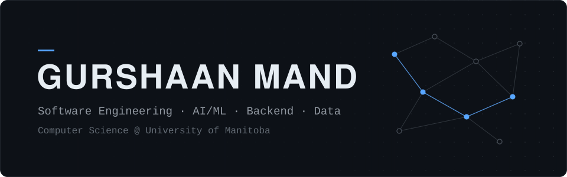

I'm a Computer Science student at the University of Manitoba. Most of what I build is backend and data-heavy software in Python, and lately a lot of it involves embedding models and LLM tooling.

[LinkedIn](https://www.linkedin.com/in/gurshaan-mand-b9457a320/) &nbsp;·&nbsp; [Website](https://gurshaanmand.com)

## Projects

### [Video Condenser](https://github.com/GurshaanMand/VideoCondensor)

A web app that cuts a long YouTube video down to the parts that match an objective you describe. It scores every transcript segment for relevance, redundancy and information content, then renders the kept ranges into one MP4.

transcript → 20s segments → MiniLM embeddings → topic grouping → multi-signal scoring → filtering → FFmpeg render

Python · FastAPI · Sentence Transformers · scikit-learn · FFmpeg · Docker · AWS ECS

### [session-saver-mod](https://github.com/GurshaanMand/session-saver-mod)

A Claude Code mod that makes token spend visible while you work: a per-prompt cost receipt, context-window warnings, a confirmation before very large file reads, and commands to route requests to a cheaper model. Seven features, each in its own module with its own tests.

TypeScript · Claude Code mods API

## Technologies

| | |
|---|---|
| **Languages** | Python · Java · TypeScript · JavaScript · SQL |
| **AI / Data** | Sentence Transformers · scikit-learn · NumPy · pandas |
| **Backend** | FastAPI · REST APIs · SQLite |
| **Tools** | Docker · AWS (ECS, ECR) · FFmpeg · Git |

Reach me on [LinkedIn](https://www.linkedin.com/in/gurshaan-mand-b9457a320/).
